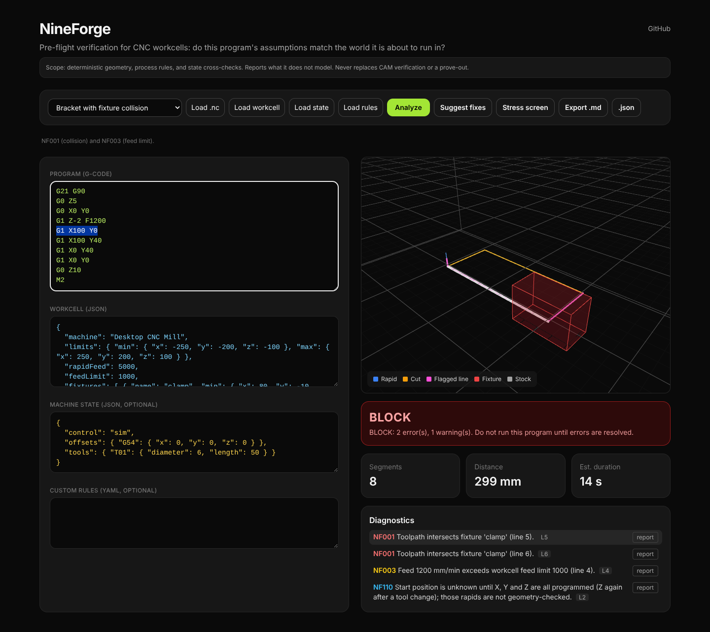
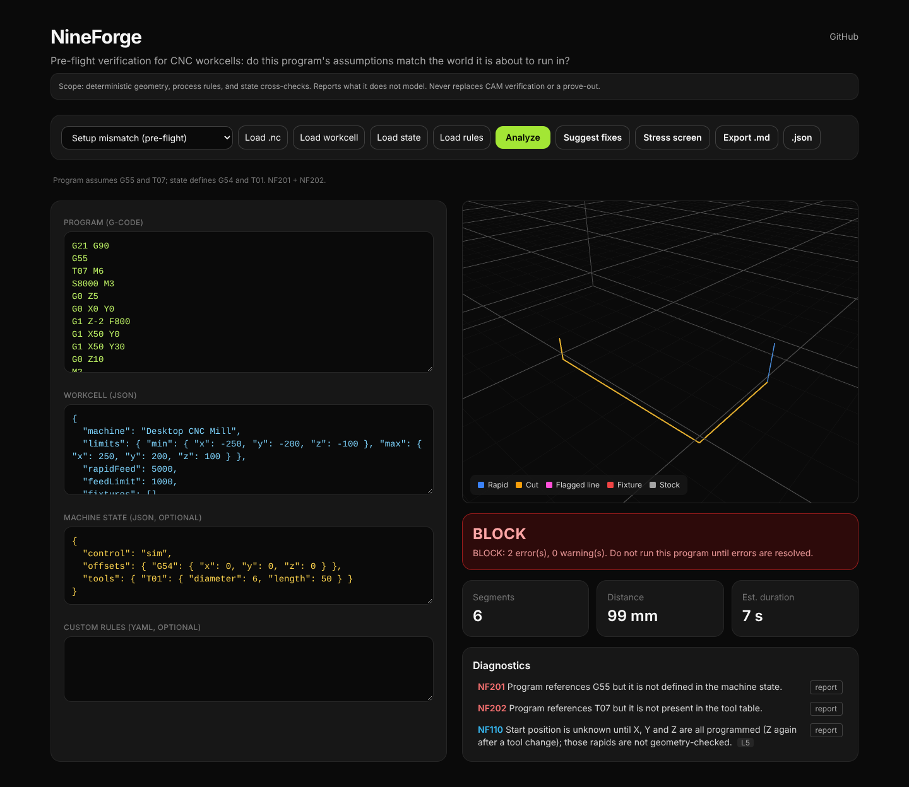
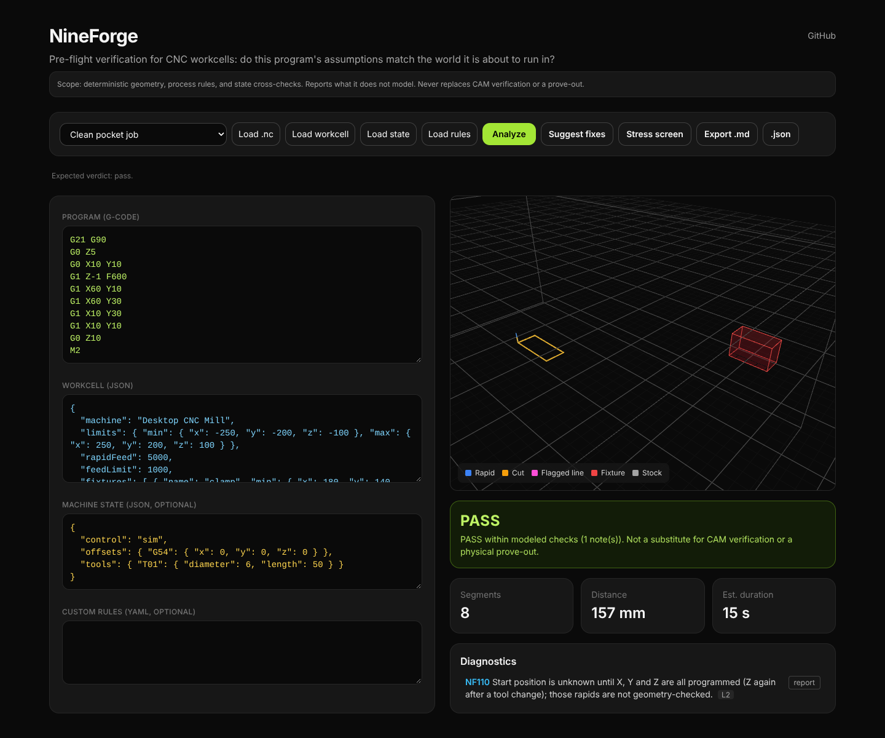
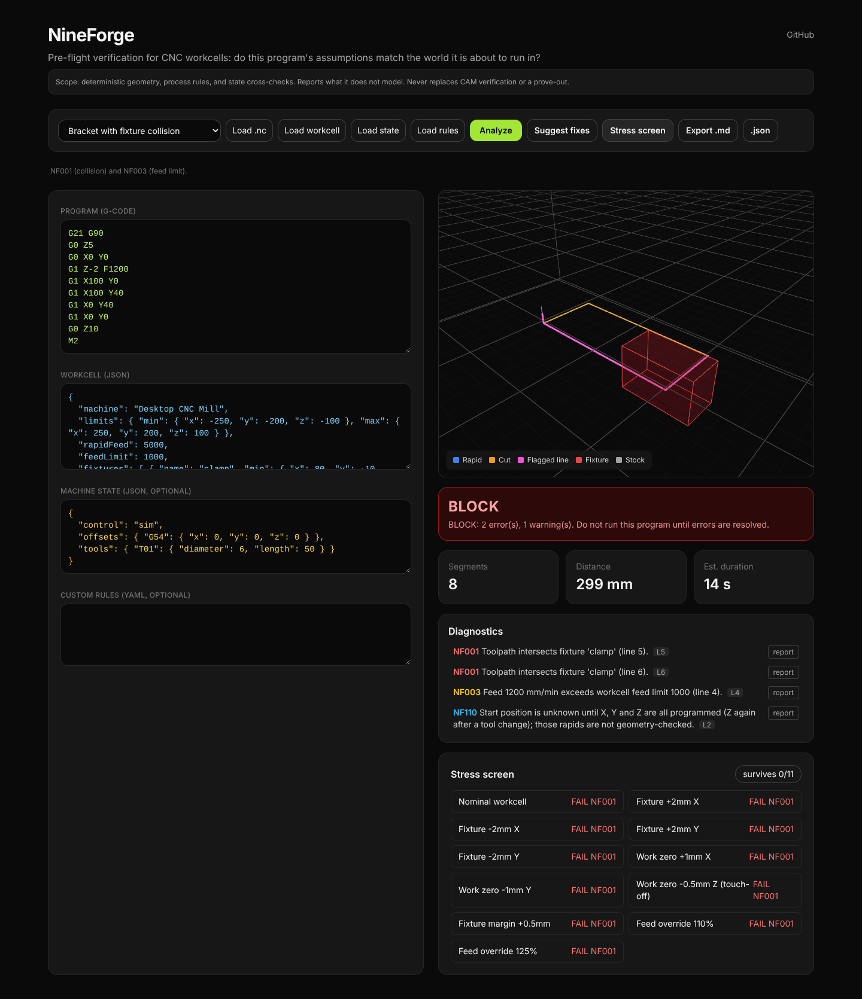
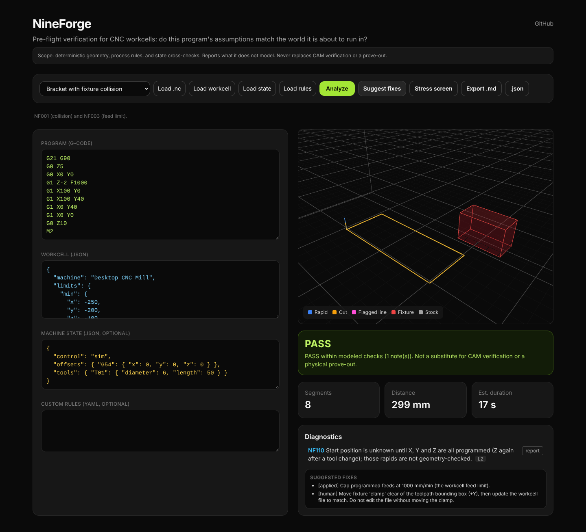
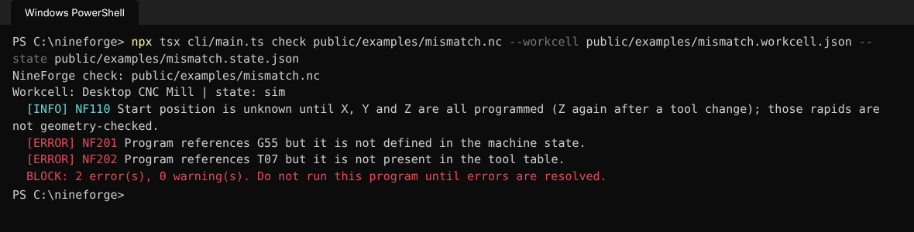
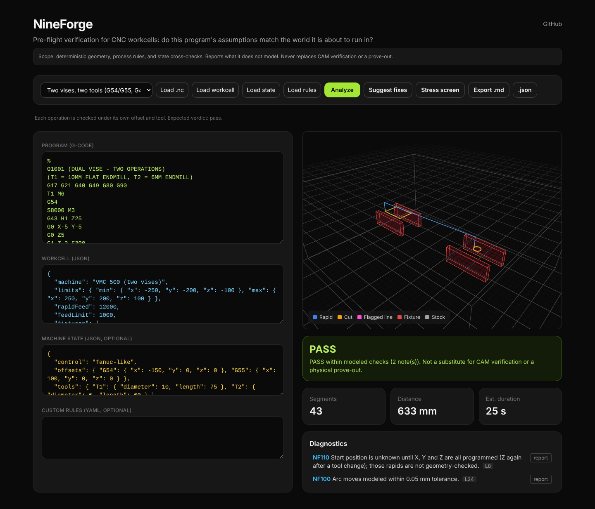
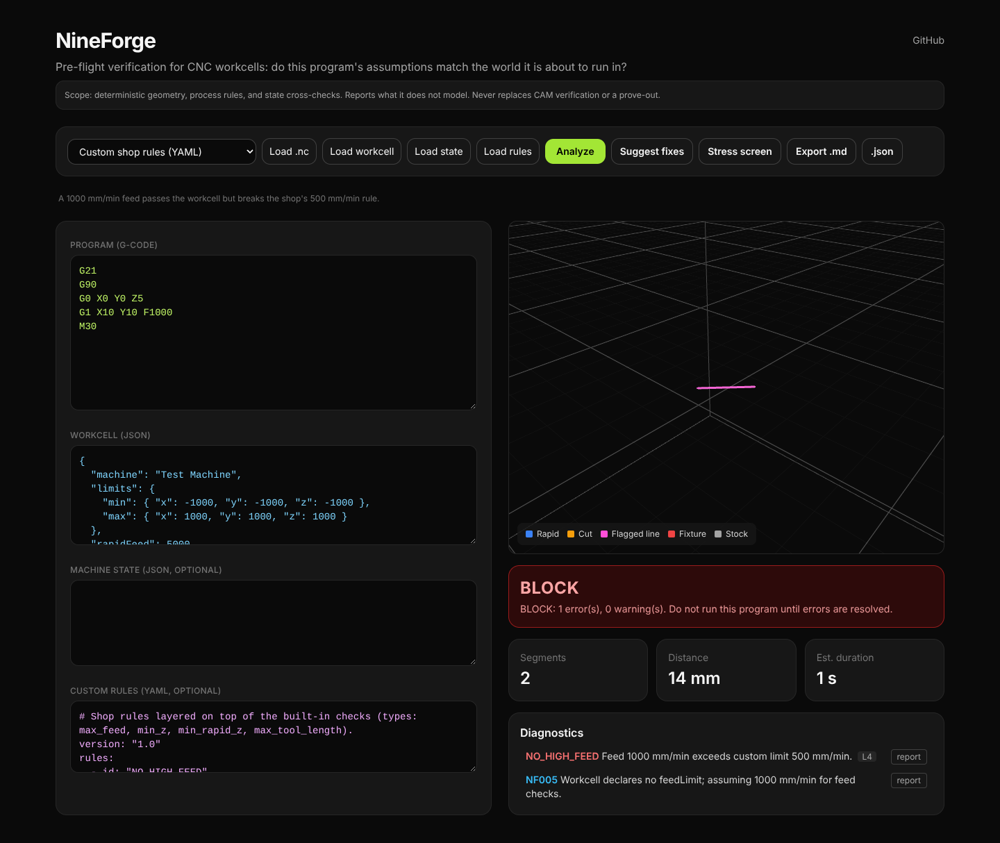
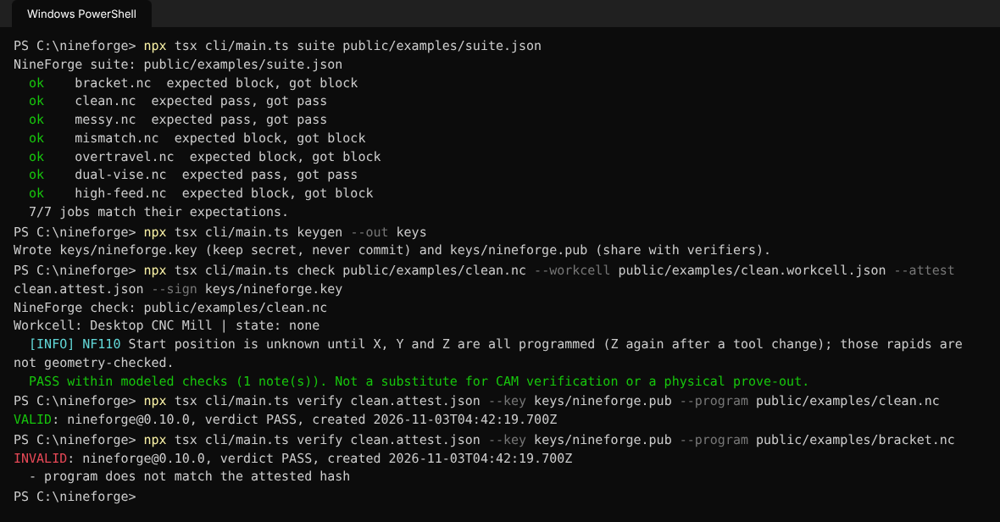

# NineForge

**Unit testing for the physical world.**

[](https://github.com/Arley100/nineforge/actions/workflows/validate-nc.yml)
[](LICENSE)

NineForge is an open-source, deterministic validation layer for machine programs written by
AI agents (or people). It sits between whatever writes the motion code and the hardware that
would execute it, and checks every program against the *actual* workcell (travel limits,
fixtures, stock) and machine state (work offsets, tool table) **before anything moves**.

The current focus is **3-axis CNC milling G-code**. The engine is meant to cover other
machine classes over time (see the [roadmap](#gated-roadmap)).

> **Scope honesty:** NineForge models deterministic geometry, process rules and state
> cross-checks, and it reports what it does *not* model. It complements, and never
> replaces, CAM verification and a physical prove-out.

## Why

AI agents now write machine programs faster than anyone can review them. In software, a
hallucination is a bad string. On a machine, a hallucinated work offset or a toolpath
through a clamp is a broken fixture, a scrapped part or an injured operator.

- **CAM verification** is human-paced and GUI-bound; it can't sit inside an agent loop.
- **Physical prove-outs** are slow and expensive, and they don't scale with token throughput.
- **Nothing produces machine-checkable evidence** that a program was validated against the
  real workcell state.

NineForge's answer is fast, deterministic, CI-friendly checks that **block by default when
evidence is missing**, plus signed reports that prove what was checked.

## Quickstart

Requires Node.js 20.9 or newer (22 LTS recommended).

```bash
npm install
npm run dev            # web UI at http://127.0.0.1:5173
```

Check a program from the terminal (the same commands work in PowerShell, cmd and bash):

```bash
npm run nf -- check public/examples/mismatch.nc --workcell public/examples/mismatch.workcell.json --state public/examples/mismatch.state.json
```

Run with Docker:

```bash
docker build -t nineforge .
docker run --rm -p 3000:3000 nineforge     # http://localhost:3000
```

## UI tour

Every screenshot below is captured from the real app by `scripts/capture-screenshots.cjs`
(see [docs/SCREENSHOTS.md](docs/SCREENSHOTS.md)).

### 01 - Block: toolpath vs fixture

Flagged lines turn pink in the 3D view. Clicking a diagnostic selects its line in the editor
and highlights the move in white.

### 02 - Pre-flight: setup mismatch

The program calls for `G55` and `T07`; the loaded machine state defines neither.
**BLOCK** before anything moves.

### 03 - Pass: clean pocket job

A program whose assumptions match the workcell passes every modeled check.

### 04 - Stress screen

The stress screen perturbs the setup (fixture shifts, work-zero errors in X, Y and Z, fixture
wear, feed overrides) and re-runs every check, showing which codes fail under each
perturbation.

### 05 - Suggested fixes

Typed suggestions: `gcode-edit` actions an agent may apply (feeds capped at the workcell
limit, unit- and G95-aware) and `physical-action` actions a human must perform (move the
clamp; editing the file does not move the clamp).

### 06 - CLI

Same engine, no browser.

### 07 - Multi-operation programs

A CAM-style program with two vises (`G54`/`G55`) and two tools with `G43` length
compensation. Every move is checked under its *own* work offset and tool radius.

### 08 - Custom shop rules

YAML rules layered on top of the built-in checks: here a 1000 mm/min feed is inside the
machine's limit but breaks the shop's 500 mm/min rule.

### 09 - Evidence: regression suites and signed reports


## CLI

```text
nineforge check <program.nc> --workcell <cell.json> [--state <state.json>] [--rules <rules.yaml>]
                [--json] [--stress] [--strict] [--sarif <out.sarif>]
                [--attest <out.json> [--sign <private.pem>]] [--history <runs.jsonl>]
nineforge suite <suite.json> [--json]
nineforge verify <attestation.json> [--key <public.pem>] [--program <file>] [--workcell <file>] [--state <file>] [--rules <file>]
nineforge keygen [--out <dir>]
```

From a checkout, run it as `npm run nf -- <args>` or `npx tsx cli/main.ts <args>`. After
`npm run build:lib` (or installing the package) it is also available as `nineforge`.

| Exit code | Meaning |
|-----------|---------|
| 0 | Pass (or caution without `--strict`); suite and verification succeeded |
| 1 | Blocked, a stress perturbation blocked, a suite expectation failed, verification failed, or the verified report's verdict is block |
| 2 | Usage or input error (missing file, bad flag, invalid rules file) |

Output is colored on a terminal; set `NO_COLOR=1` to disable it. Invalid workcell or state
JSON never crashes the CLI: it becomes a fail-closed `NF107` block.

## Evidence over time

**Regression suites.** A suite pins the expected verdict (and optionally the codes) for every
program that runs on a workcell. A program change that breaks a known-good job fails the suite:

```json
{
  "workcell": "cell.json",
  "state": "state.json",
  "jobs": [
    { "program": "op10.nc", "expect": "pass" },
    { "program": "known-crash.nc", "expect": "block", "codes": ["NF001"] }
  ]
}
```

Paths are relative to the manifest; `workcell`, `state` and `rules` can be set per job.
`public/examples/suite.json` covers every bundled example and runs in CI.

**Signed reports.** An attestation records the report, the engine version and the SHA-256 of
every input, signed with Ed25519:

```bash
npm run nf -- keygen --out keys                       # keys/nineforge.key stays private
npm run nf -- check part.nc --workcell cell.json --state state.json --attest part.attest.json --sign keys/nineforge.key
npm run nf -- verify part.attest.json --key keys/nineforge.pub --program part.nc --workcell cell.json --state state.json
```

`verify` fails if the report was edited, if any supplied input differs from what was checked,
or if a different key signed it. Without `--key` it checks integrity only and says so. An
authentic report whose verdict is BLOCK still exits 1, so a pipeline gate cannot wave it through.
Private keys (`*.key`, `*.pem`) are git-ignored; keep them in your CI secret store.

**Run history.** `--history runs.jsonl` appends one line per check (time, program path and
hash, verdict, codes) for audit trails and dashboards.

**CI and SARIF.** `--sarif out.sarif` writes SARIF 2.1.0 with a location for every finding,
so findings annotate `.nc` files in a pull request's "Files changed" tab.
`.github/workflows/validate-nc.yml` typechecks, tests, builds, runs the Python tests and the
regression suite, and uploads SARIF on every PR.

## Integrations

### REST API

The web app exposes:

- `POST /api/analyze`: `{ gcode, workcell, state?, rules? }` returns `{ result, reportVersion, summary }`.
  `workcell`/`state` may be JSON strings or objects; `rules` a YAML/JSON string or an object.
  Limits: 2,000,000 characters of G-code and 500,000 per JSON document (HTTP 413 above them).
- `POST /api/batch`: an array of up to 10 jobs (each with an optional `id`). A malformed job
  gets its own `error`; healthy jobs still get full reports.
- `GET /api/openapi`: the OpenAPI 3.1 specification.

```bash
curl -s -X POST http://127.0.0.1:5173/api/analyze -H "content-type: application/json" \
  -d '{"gcode":"G21 G90\nG0 X0 Y0 Z5\nG1 X10 F500","workcell":{"limits":{"min":{"x":-100,"y":-100,"z":-50},"max":{"x":100,"y":100,"z":50}}}}'
```

### MCP server (agent integration)

```bash
npm run mcp            # or: npx tsx mcp/server.ts, or nineforge-mcp once built
```

```json
{
  "mcpServers": {
    "nineforge": { "command": "npx", "args": ["tsx", "mcp/server.ts"], "cwd": "/path/to/nineforge" }
  }
}
```

Tools (all take `gcode`, `workcellJson`, optional `stateJson` and `rules`):
`nineforge_check` (versioned report), `nineforge_fix` (typed actions: `gcode-edit` actions are
auto-applicable, `physical-action` never are) and `nineforge_stress`.

`npm run demo:agent-loop` shows an agent closing the loop: block, apply the feed fix, issue
the clamp work order, pass.

### Core library

```bash
npm run build:lib      # dist/core: ESM + CJS + type declarations
```

```ts
import { check, parseRules } from "nineforge";

const report = check(gcode, workcellJson, stateJson, parseRules(rulesYaml));
console.log(report.verdict); // "pass" | "caution" | "block"
```

`check()` is the fail-closed boundary: it never throws, and invalid workcell or state JSON
becomes an `NF107` block report. The package also exports `parseGCode`, `analyze`,
`placeSegments`, `suggestFixes`, `stress`, `toSarif`, `runSuite`, `attest`,
`verifyAttestation`, `loadRules` and all domain types.

### Python

`python/nineforge.py` pipes a job to the bundled bridge (`dist/python-bridge.js`), so the
only runtime requirement is Node.js:

```bash
npm run build:lib
python -m unittest discover python
```

```python
import nineforge
report = nineforge.check(gcode, workcell_json, state_json, rules=rules_yaml)
```

`workcell`/`state` may be JSON text or dicts; `rules` YAML/JSON text or a dict. Set
`NINEFORGE_REPO` to your checkout if the module lives outside the repo.

## Input files

Coordinates: the program is written in work coordinates. NineForge adds the active work
offset to every move (and, without `G43`, shifts the tool tip down by the tool length) to
get the **workcell frame**, where `limits`, `fixtures` and `stock` live. All units are mm.

**Workcell** (`*.workcell.json`)

```json
{
  "machine": "Desktop CNC Mill",
  "limits": { "min": { "x": -250, "y": -200, "z": -100 }, "max": { "x": 250, "y": 200, "z": 100 } },
  "rapidFeed": 5000,
  "feedLimit": 1000,
  "fixtures": [{ "name": "clamp", "min": { "x": 80, "y": -10, "z": -5 }, "max": { "x": 120, "y": 10, "z": 20 } }],
  "stock": { "min": { "x": 0, "y": 0, "z": -20 }, "max": { "x": 100, "y": 60, "z": 0 } }
}
```

`limits` is required. `rapidFeed` (default 5000 mm/min) is used for time estimates.
Without `feedLimit`, 1000 mm/min is assumed and disclosed (`NF005`). `stock` is optional.
Box corners may be given in any order.

**Machine state** (`*.state.json`, optional)

```json
{
  "control": "sim",
  "offsets": { "G54": { "x": 0, "y": 0, "z": 0 }, "G55": { "x": 150, "y": 0, "z": 0 } },
  "tools": { "T1": { "diameter": 6, "length": 50 } }
}
```

Offsets `G54`-`G59` and `G59.1`-style names are supported; `T1`, `T01` and `T001` all name tool 1.

**Custom rules** (`*.yaml` or `*.json`, optional)

```yaml
version: "1.0"
rules:
  - { id: NO_HIGH_FEED, severity: error, type: max_feed, params: { max: 500 } }        # mm/min
  - { id: FLOOR, severity: error, type: min_z, params: { min: -25 } }                 # program Z
  - { id: CLEARANCE_PLANE, severity: warning, type: min_rapid_z, params: { min: 3 } } # horizontal rapids
  - { id: SHORT_TOOLS, severity: warning, type: max_tool_length, params: { max: 80 } }
```

Rules are evaluated in program coordinates. Parameters are validated per rule type, so a
typo such as `maximum:` fails loudly instead of silently disabling the rule.

## Architecture

Every surface converges on the same fail-closed `check()` boundary, which returns a versioned
report (`reportVersion: 1`).

```
  +----------------+  +----------------+  +----------------+  +----------------+
  | Web UI         |  | CLI: check,    |  | MCP server     |  | REST API       |
  | (Next.js)      |  | suite, verify, |  | nineforge_*    |  | /api/analyze   |
  |                |  | SARIF, attest  |  |                |  | /api/batch     |
  +-------+--------+  +-------+--------+  +-------+--------+  +-------+--------+
          |                   |                   |                   |
          +-------------------+---------+---------+-------------------+
                                        |
                                        v
                              +-------------------+      +----------------+
                              | lib/check.ts      |<-----| Python bridge  |
                              | fail-closed SDK   |      | (stdin/stdout) |
                              +---------+---------+      +----------------+
                                        |
                                        v
                              +-------------------+      +----------------+
                              | parse / analyze / |----->| nineforge core |
                              | rules / perturb   |      | ESM+CJS+d.ts   |
                              +-------------------+      +----------------+
```

## The validation pipeline

Any `error` forces the verdict to `block`; warnings downgrade to `caution`; `pass` requires a
clean trace end to end. Missing evidence is disclosed (`NF005`, `NF100`, `NF110`, `NF206`)
or blocks (`NF105`, `NF106`, `NF107`, `NF207`); it is never guessed silently.

```
  program.nc + workcell.json + state.json (+ rules.yaml)
                   |
                   v
           +----------------+  segments with their own work offset, tool and
           | 1. PARSE       |  length compensation; arcs in G17/G18/G19 tessellated
           +----------------+  to <= 0.05 mm; unknown start position tracked
                   |
                   v
           +----------------+  program calls G55/T07, state defines neither
           | 2. PREFLIGHT   |  -> hard BLOCK before motion
           +----------------+
                   |
                   v
           +----------------+  toolpath vs fixtures, stock and travel; tool
           | 3. ANALYZE     |  radius + length; feeds; spindle; custom rules
           +----------------+
                   |
                   v
           +----------------+  block | caution | pass
           | 4. VERDICT     |
           +----------------+
                   |
                   v
           +----------------+  versioned report for CLI, UI, MCP, SARIF;
           | 5. REPORT      |  optional signed attestation
           +----------------+
                   |
   +---------------+---------------+
   v                               v
+----------------+          +----------------+
| 6. FIX         |          | 7. STRESS      |
| gcode-edit vs  |          | perturb setup, |
| physical-action|          | survives k/N   |
+----------------+          +----------------+
```

Stress never *upgrades* a verdict; it only adds evidence. `survives 0/11` means the baseline
and every perturbation still fail.

## What we model - and what we don't

**Modeled exactly** (locked by the differential corpus and property tests):

- Linear/rapid motion (G0/G1), modal state, space-less words (`G1X10Y10`); G-codes in a
  block take effect before its axis words (`X1 G20` is one inch)
- Arcs G2/G3 in all three planes (G17 I/J, G18 I/K, G19 J/K) in I/J/K and R forms, helical
  moves and full circles, tessellated to <= 0.05 mm chord tolerance (`NF100` discloses this)
- G90/G91, G20/G21 including mid-program unit switches, G94/G95 (feed per revolution
  uses the programmed S)
- Work offsets G54-G59 and G59.x **per move**: multi-fixture programs are checked under the
  offset each operation actually uses, and the traverse when switching offsets is checked
  from where the machine really is (axes not yet re-programmed stay in their old offset)
- Tools **per move** (T preselect + M6): each move uses its own tool radius (`NF205`) and
  length; with G43 the tip follows programmed Z, without it the tip is assumed `length` mm
  below (`NF206`); G43 with an unknown H, or the H of a different tool than the loaded one,
  blocks (`NF207`). Toggling G43 without moving keeps later incremental Z moves exact
- Exact slab-method segment/box intersection (no tunneling through thin fixtures)
- Stock volume: rapid-in-stock (`NF006`), air cut (`NF007`), cutting below the stock (`NF008`)
- Spindle state: cutting after M5, with S0, or after a tool change without M3/M4 blocks
  (`NF109`); nothing after M2/M30 runs
- Unknown positions are never invented: at program start (and for Z after a tool change)
  a move is checked once its endpoint is fully programmed, at that endpoint. Earlier rapids
  are disclosed (`NF110`); earlier *cutting* moves are a warning (`NF111`)
- Block delete (`/`): both paths are checked, with the switch off and on

**Fail closed (block, never guessed)** - `NF106`:

- **Every G-code outside an allowlist** of modeled or geometry-neutral codes (G0-G4, G8, G9,
  G15, G17-G21, G40, G43, G49, G50, G50.1, G54-G59.x, G61-G64, G67, G69, G80, G90, G91,
  G91.1, G94, G95, G97-G99, G103, G187). That includes homing and machine coordinates
  (G28/G30, G53), probing, canned cycles, cutter compensation (G41/G42), G44, coordinate
  transforms (G10, G16, G51, G52, G68, G92, extended offsets G54.1/G154/G110+), inverse-time
  feed, splines and macro calls
- Subprogram flow (M97, M98, M99, M198) and rotary/secondary axes (A B C U V W)
- Unparseable words or text, non-finite geometry, and programs that expand to more than
  500,000 moves (`NF105`); inconsistent arc data (`NF103`); invalid workcell/state JSON
  through the SDK (`NF107`)

**Not modeled (reported or disclosed, never silently trusted):**

- Unknown address letters (E, ...) are reported (`NF102`); N, O, P, Q, L, D are parameters
- After a tool change, X and Y are assumed unchanged (true for most mills; machines that move
  X/Y to a change position should re-state X/Y after M6, as CAM posts do)
- Constant surface speed (G96) and other lathe semantics
- Cutting forces, tool deflection, machine dynamics, controller lookahead, material behavior

### Diagnostic codes

| Code | Severity | Meaning |
|------|----------|---------|
| NF001 | error | Toolpath intersects a fixture |
| NF002 | error | Motion exceeds machine travel limits |
| NF003 | warning | Feed exceeds the workcell `feedLimit` (reported where the feed takes effect) |
| NF004 | warning | Horizontal rapid less than 2 mm above the stock top (or Z0) |
| NF005 | info | No `feedLimit` declared; assuming 1000 mm/min |
| NF006 | error | Rapid (G0) intersects the declared stock volume |
| NF007 | warning | Air cut: cutting moves never intersect the stock |
| NF008 | error | Cutting below the stock bottom (table/vise risk) |
| NF100 | info | Arcs modeled as chords within 0.05 mm tolerance |
| NF102 | info | Unmodeled word ignored (reported) |
| NF103 | error | Arc center data missing or inconsistent |
| NF104 | warning | Cutting move before any F word |
| NF105 | error | Unparseable word / non-finite geometry |
| NF106 | error | Unmodeled motion, transform, subprogram or rotary axis |
| NF107 | error | Invalid workcell/state JSON (SDK fail-closed) |
| NF108 | warning | G95 feed per revolution without an S word |
| NF109 | error | Cutting move with the spindle off (M5 or S0) |
| NF110 | info | Start position unknown; early rapids not geometry-checked |
| NF111 | warning | Cutting move from an unknown position (not geometry-checked) |
| NF201 | error | Work offset referenced but not in machine state |
| NF202 | error | Tool referenced but not in tool table |
| NF203 | error | Work envelope under an offset exceeds machine travel |
| NF205 | error | Tool radius sweeps a fixture |
| NF206 | warning | No G43 active; tip assumed `length` mm below programmed Z |
| NF207 | error | G43 H not in the tool table, or not the loaded tool |

Retired: `NF101` (G91 is modeled) and `NF204` (multiple work offsets are now modeled per move).

## Evidence, not vibes

- **165+ tests** (`npm test`): unit, regression, property-based invariants (chain
  continuity, mm/inch round-trip stability, monotonic fixture growth, finite stats),
  differential corpus, rule engine, fixes and stress, REST endpoints, signed attestations,
  regression suites, CLI and MCP end-to-end, plus Python binding tests.
- **Differential corpus:** `tests/corpus/*.nc` with golden segment dumps. Regenerate
  deliberately with `npx tsx scripts/dump-corpus.ts`; the `.expected.json` diff is a review
  surface, never a silent change.
- **Docs are tested too:** the diagnostic table above must match the engine's code catalog.

## Gated roadmap

A gate closes only when its evidence (tests, examples, screenshots, docs) is in the repo.

| Gate | Status | Goal | Exit criteria |
|------|--------|------|---------------|
| **0** | shipped | Deterministic 3-axis validation: parse, preflight, analyze, verdict, report, fixes, stress, CLI. | Examples, tests, screenshots in this repo. |
| **1** | shipped | Agent-native: versioned report SDK, MCP server, SARIF + CI annotations, agent-loop demo. | `npm run demo:agent-loop` closes block -> self-correct -> pass with no human in the loop. |
| **2** | in progress | Deeper physics. Shipped: tool diameter and length/comp semantics per move, multi-offset programs, arcs in all planes. Remaining: 4/5-axis kinematics and rotary envelopes. | 5-axis example suite with evidence parity to Gate 0, plus an updated "not modeled" list. |
| **3** | open | Second machine class (e.g. FDM motion plans) with the same pipeline and a new workcell schema. | New example suite + screenshots; engine core untouched by machine-specific code. |
| **4** | shipped | Evidence over time: regression and differential suites, per-workcell suites, run history, signed reports. | A regression suite catches a deliberately broken program change on a real workcell (`tests/features.test.ts`). |

## Contributing

PRs must keep `npm run typecheck`, `npm test` and `npm run build` green. Fail closed by
default, disclose every assumption, and document what a new capability does **not** model.
If you change the UI, re-capture the screenshots ([docs/SCREENSHOTS.md](docs/SCREENSHOTS.md)).
Corpus goldens are reviewed, never silently regenerated. See [CHANGELOG.md](CHANGELOG.md).

Found a false positive or a missed crash? Use the **report** link next to any diagnostic in
the UI, or open an issue with a minimal program, workcell and state.

## License

MIT - see [LICENSE](LICENSE).
